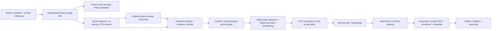

# Expo Design AI — Architectural Image Editing Audit
**Date:** 15 October 2026, Asia/Dubai. **Disposition:** read-only audit complete; implementation requires approval.

## 1. Scope and evidence
Inspected current Expo image API, client, registry, job service, storage, reasoning module, schemas, UI, configuration, active workflows, two workflow backup directories, ComfyUI package metadata/model files and SQLite via read-only connections. Existing workspace contains extensive modifications/deletions; none reverted. No application imports, package/model installations, service changes, image generation, HTTP/WebSocket requests or other network requests performed during this audit. Only this requested report was created.

Evidence levels: **reproduced** means a pure in-memory experiment against the current method; **code verified** means execution path inspected; **historical evidence** means saved jobs/logs, not a fresh run. Installed files do not prove current service availability or output fidelity. No repository test suite executed, because some existing tests initialize the application's database; no passing-suite claim.

## 2. Architecture and execution flow

`api.py` requires project access for jobs and output access checks; `ImageStorage` uses project-contained paths, validates multipart image bytes and writes inputs/outputs atomically. `job_service.py` uploads reference bytes, replaces `LoadImage` filenames using the renderer response, tracks execution, persists outputs and marks completion. Output files and DB records are useful operational records; no geometry-validation stage exists.

## 3. Verified models, workflows, dependencies
| UI workflow | Actual graph and installed model | Reference mechanism / settings |
|---|---|---|
| Architecture Concept | `architecture_concept.json`, v1.1.0; UNETLoader `flux-2-klein-4b.safetensors`; Qwen text encoder; FLUX VAE | Text-only, zero negative conditioning; metadata says distilled four steps/CFG 1 |
| Render Enhancement | `render_enhancement.json`, v2.0.0; same installed diffusion filename | LoadImage → ImageScaleToTotalPixels (1 MP) → VAEEncode → ReferenceLatent on positive AND negative conditioning; new EmptyFlux2LatentImage; metadata defaults 20 steps/CFG 5 |
| Sketch to Render | `sketch_to_render.json`, v2.0.0; same diffusion filename | Same reference-conditioning topology with different default prompts/output prefix |

Model files verified by existence/size, not rehashed: diffusion 7,751,105,712 bytes; `qwen_3_4b.safetensors` 8,044,982,048 bytes; `flux2-vae.safetensors` 336,213,556 bytes. No new model needed for the first implementation stage.

ComfyUI isolated environment metadata: torch 2.14.1+cu130, torchvision 0.29.1+cu130, torchaudio 2.11.0+cu130, safetensors 0.8.0, transformers 5.19.0, Pillow 12.3.0. Expo Python metadata: FastAPI 0.141.1, httpx 0.28.1, websockets 16.1.1, SQLAlchemy 2.0.54. httpx/websockets are not installed in the inspected ComfyUI venv; they belong to Expo's client environment. No CUDA execution or package compatibility test repeated today. Prior GPU success is historical, not fresh certification.

**Qwen is integrated**, not merely proposed: `prompt_reasoner.py:19–20` selects local Ollama `qwen3.5:9b`; `/api/image-engine/enhance-prompt` invokes it and job execution optionally invokes it when `enhance_prompt=True`. UI has an enhancement action and optional enhancement submission. The local Ollama manifest exists (layer bytes total 6,550,825,373). The reasoning request uses `think=False`, JSON output and `keep_alive=0` when requested. Current running/loaded model and service health remain unverified because the task forbids network requests. Existing installed Ollama is the runtime; no new SDK or model is justified. A text-only reasoning request does not inspect the source image or prove its floor count.

**Historical success:** read-only DB shows 7 completed Architecture Concept jobs and 4 completed Render Enhancement jobs. Latest enhancement IDs include `imgjob-b580d93017b6`, `imgjob-2ec9bb39d73e`, `imgjob-82cae7b591de`; saved logs corroborate completion. Source/output geometry has not been compared in this audit.

**Backups:** `workflow_backup_20261015_210242/` and `workflow_backup_flux2_klein_20261015_212458/` contain identical older KSampler-based render/sketch workflows. They are NOT backups of today's active ReferenceLatent graphs. Active enhancement SHA-256: `bf985936d825d421171ddd43ff8a29b6c56ce9aaec02b5c6b2283f95d58adf5e`; active sketch: `335b418ae5b71dc5057d706c54b69ff75fe8cfe96fa79027772b9ee86acfd582`. `workflows/image_flux2_klein_image_edit_4b_base.json` is a UI-format template, distinct from registered API-format graphs. Preserve it as provenance; do not treat its name as proof that installed weights are the base variant.

## 4. Limitations and reproduced defects
| Priority / evidence | Finding and locations | Consequence |
|---|---|---|
| P1 / reproduced | `workflow_registry.py:345` unconditionally binds dimensions on EmptyFlux2LatentImage; scheduler keeps GetImageSize links (`:368`). A pure current-method call with 1024×768 replaces the edit latent links while scheduler still reads source dimensions. | Reference/output aspect or scheduler token geometry can diverge; preservation is weakened. |
| P1 / reproduced | `workflow_registry.py:338` replaces the positive text with caller text plus a generic visualization suffix. Experiment used “Change only cladding. Preserve camera and openings.”; detailed baseline preservation text disappeared. | Working workflow's guardrails are not reliably retained after normal submission. |
| P1 / code | Render/sketch graphs use ReferenceLatent conditioning, but sample from an empty latent. No mask, mask crop, inpainting constraint, original-pixel compositing, protected-region/signage restoration or geometry comparison found in inspected Studio paths. | Floors, openings, slabs, outline, perspective and signs can change. Prompt constraints cannot guarantee structural fidelity. |
| P1 / code | `job_service.py:108–117` comments call the installed plain `flux-2-klein-4b` regular/base, but four-step normalization is selected for filenames containing `distilled` OR `base-4b-fp8`. Concept metadata says four-step distilled; edit metadata says base/20/5, all pointing at the plain file. | Filename heuristics and labels are inconsistent. Prove model variant/settings before tuning; a base filename must not automatically mean distilled. No replacement model recommended. |
| P1 / code | `prompt_reasoner.py:22` mandates new camera optics, façade schemes, cantilevers/terraces and physical details. `_enforce_invariants` covers limited textual patterns, not image geometry. | Enhancement can become redesign even when the user only requests materials. “Preserved constraints” is a claim from prompt processing, not a visual validation result. |
| P1 / code | `denoise` exists in schema, but binds only KSampler nodes; active edit graphs use SamplerCustomAdvanced and no denoise-consuming node. Negative conditioning is present in edit graphs but zeroed in concept graph. Dimensions derive from reference scaling in some nodes despite generic API width/height. | Unsupported/ineffective controls and conflicting expectations. Explain exact per-workflow control semantics; do not sell denoise as a preservation slider here. |
| P1 / code | `job_service.py:49,78` stores pending jobs in asyncio.Queue; reconciliation fails running rows but does not restore persisted queued rows. Timeout marks failed without confirmed renderer interruption; cancellation uses a global interrupt and terminal-state races are possible. `comfyui_client.py` subscribes after submission and may miss completion events; polling accepts nonempty outputs before confirmed completion. | Stuck jobs, wasted GPU work, false completion or cancelled jobs later completing. Single Expo worker does not serialize unrelated ComfyUI or Ollama users. |
| P1 / code | JSON job submission accepts `input_image_path`; worker opens it directly at `job_service.py:362`. Registry `extra_params` overrides inputs after readiness checks. Multipart validation does not validate arbitrary JSON paths. | Need project ownership/containment enforcement and approved-node parameter allowlists; configured graph validation alone does not cover the submitted graph. No exploit executed. |
| P1 / code | Lifecycle API permits unauthenticated loopback requests (`api.py` service routes). `service_manager.py` kills the port owner without proving service identity; startup redirects stdout/stderr to the same file and uses `--highvram`. | Process-control scope and shared-GPU behavior need hardening. Startup failure inferred from arguments, not executed. |
| P0 for strict offline sign-off / code | `main.py:5865` legacy `/api/ai/render` can invoke DashScope at `:5948` when key/provider conditions match. Provider can come from request body. Middleware exempts this route from ordinary login handling. Reasoner Ollama URL comes from environment without ComfyUI-style loopback validation. | The entire application cannot currently be certified offline-only or uniformly authenticated from the inspected code. No cloud call performed; active cloud-key configuration not inspected or printed. |
| P2 / code | Seed omitted means graph default 42 can persist while stored request seed is null; record does not comprehensively capture graph/model/input hashes and runtime. Gallery/lightbox exists, but no verified before/after overlay, image-geometry checks or provenance-linked variant batches. | Incomplete reproducibility and no measurable preservation evidence. Three Qwen text options are not three images from the same immutable reference. |

## 5. Prioritized, reversible implementation plan
Each stage requires separate approval, a new snapshot of CURRENT files/workflows and an independently testable change set. Preserve the successful enhancement path as a baseline throughout.

| Stage / impact / risk | Files proposed | Approach / dependencies | Acceptance and rollback |
|---|---|---|---|
| **1. Contract correctness and local boundary** / high / low–medium | `workflow_registry.py`, `job_service.py`, `schemas.py`, `api.py`, `prompt_reasoner.py`, `service_manager.py`, `ui/app.js`, legacy render route/config; focused tests | Preserve linked edit dimensions; bind prompts through explicit positive/negative roles and retain mode-specific constraints; declare model variant/settings explicitly; reject unsupported controls; resolve effective seed before saving. Validate reference ownership and final overridden graph. Enforce loopback/offline-only inference and authenticated, identity-checked lifecycle operations. Do not overwrite graphs or install packages. | Mapping tests across portrait/landscape images show scheduler and latent sizes match the selected policy. Prompt constraints retained. Null seed yields a stored concrete seed. Invalid paths/nonloopback URLs/cloud provider requests rejected before any I/O. Previous successful enhancement fixture still builds and submits unchanged where policy permits. Roll back only stage snapshots/feature switch. |
| **2. Explicit editing modes** / high / medium | new `prompt_builder.py`; new additive workflow JSONs; registry/schemas/UI/tests | Separate creative façade redesign, conservative materials and photoreal enhancement; structured fields for requested changes/protected elements/materials/lighting/camera. Reasoner must respect editing mode and preserve source camera by default; show final prompt before submission. Keep baseline workflow selectable. | Approved protected-element strings survive binding; conservative mode adds no floor/camera/massing changes; creative mode clearly states permitted changes. Negative constraints never advertised as guarantees. Disable new mode registration to roll back. |
| **3. Masked edit + original compositing** / highest preservation impact / medium–high | new `mask_service.py`, `comparison.py`, additive `facade_masked_edit.json`; storage/API/schemas/job/UI/tests | Upload/select mask, define polarity, dimensions and EXIF alignment; generate candidate with existing local nodes where supported; composite candidate inside the approved mask and original outside. Store raw candidate AND composited final with mask/source hashes. Protect signage/openings with excluded regions. Verify local node availability before enabling; no automatic downloads. | Hard-mask protected pixels: EXACT byte equality outside mask at aligned original resolution, including alpha. With feathering, only declared transition band may change. Wrong size/polarity/empty mask rejected. Internal masked geometry remains a measured review issue. Roll back additive mode; preserve original/candidate artifacts. |
| **4. Reliability, alternatives and comparison** / high / medium | job/client/storage/API/UI/tests; DB migration only if approved | Recover pending jobs; distinguish queue/model-load/sampling/save time; cancellation confirmation and prompt-ID ownership; deadline budget spans WS and polling; exact terminal state handling. Persist immutable source, mask, effective seed, graph/model/settings hashes. Produce 3 alternatives via 3 recorded seeds using same source/mask. Add wipe/overlay and review checklist. | Crash/restart/ComfyUI restart tests produce no silently stranded or duplicate jobs. Cancelled/failed jobs cannot become successful. Timeout releases or explicitly marks outstanding renderer work. Alternatives share source/mask hash and distinct seeds; restore snapshots and reverse only an approved additive migration. |
| **5. Local Qwen assistance and measured QA** / medium / medium | reasoner/model settings/job scheduler/UI; geometry evaluation fixtures | Reuse installed qwen3.5:9b only; structured JSON brief with protected constraints, no automatic structural approval. Serialize reasoning and rendering where needed; verify model unloading, peak VRAM and concurrent QA contention. Add geometry landmarks/edges and human verification; OCR checks supplement, never certify signage preservation. | Manual constraints correct in every acceptance case; peak VRAM stays within measured budget with reserve; p50/p95 timing reported from multiple runs. No OOM under defined workload. Fixed-input repeats judged with declared tolerances, not guaranteed bitwise-identical GPU diffusion. Disable reasoning option to roll back. |

Stage 1 is the recommended first implementation stage. Stage 3 is the essential next stage for an actual “edit only this façade” promise. Better prompts alone are insufficient.

## 6. Offline compatibility
Core ComfyUI client rejects nonloopback hosts. Local image weights and Qwen manifest are present. Current Stage-1 plan requires no additional models/custom nodes. Offline enforcement must cover all render routes, configured reasoning URLs, redirects/proxies, custom-node startup behavior and frontend assets. Inspect ComfyUI/custom-node startup for remote update/download paths before clean-machine sign-off; not audited exhaustively here. Resolve dependencies into a pinned wheelhouse/model manifest for later disconnected installation tests. Avoid global Python/environment/driver changes. `keep_alive=0` requests unloading; it does not prove a free-GPU budget or cross-process mutual exclusion.

## 7. Test plan and approval criteria
1. Pure contract tests with actual saved API graphs: input bytes/filename reach LoadImage; VAEEncode/ReferenceLatent remain connected; portrait, landscape, EXIF-rotated and transparent images align; dimensions and effective settings agree end to end.
2. Frozen visual set: at least 12 owned images spanning villas, multi-storey façades, parking/ramp openings, oblique views and signage; independently mark floor lines, columns, openings, outline and protected zones before generation.
3. For conservative edits, set proposed thresholds before implementation: floor count unchanged in 100% of cases; outline IoU >=0.98; median protected landmark displacement <=2 px at 1024-wide evaluation (max <=5 px); any missing opening/ramp/signage or wrong floor is FAIL even if averages pass. These are proposed gates, not current results; thresholds need stakeholder confirmation on the reference set.
4. Masked final protected pixels exactly unchanged outside the declared edit/feather region. Geometry inside editable regions still needs manual review and agreed landmarks.
5. Validate three alternatives share source/mask hashes, have saved effective seeds/settings and can be compared/downloaded. Current historical outputs must remain readable.
6. Negative runtime tests after approval: unavailable model/node, renderer offline/restart, network denied, GPU contention/OOM, cancellation, process interruption, upload size limits, cross-project source/mask access and metadata errors. Use isolated DB/storage and fake transport for unit cases; run separate real local inference tests only when explicitly permitted.
7. Offline test with outbound traffic denied: no DNS/remote requests, no implicit downloads, no cloud fallback; verify all assets and local runtimes already provisioned. This audit intentionally made zero requests, so it is not an active egress test.

## 8. Backup and rollback strategy
Before approval-based edits, snapshot active workflow JSONs, affected Python/JS/config files, dependency inventory and checksums; back up SQLite safely if a schema change is approved. Existing older KSampler backups cannot restore today's working ReferenceLatent workflow. Preserve original reference images, current successful outputs and metadata. Use additive workflow IDs/feature switches for new editing modes. Restore only explicitly modified files; never blanket-reset the dirty workspace. Database rollback requires an approved migration/restore plan and ownership-scoped test data. Do not downgrade the repaired GPU environment as part of architectural editing changes.

## 9. Decision
Current application supports local generation and reference-conditioned editing with saved outputs. It does **not** establish exact geometry preservation, masked editing or application-wide offline enforcement. Approve Stage 1 to correct parameter/prompt contracts and local security boundaries while preserving today's baseline. Do not approve structural fidelity based on an attractive image.

**Stop point:** audit complete; no application edits authorized or applied in this phase. This report is the sole created artifact.
