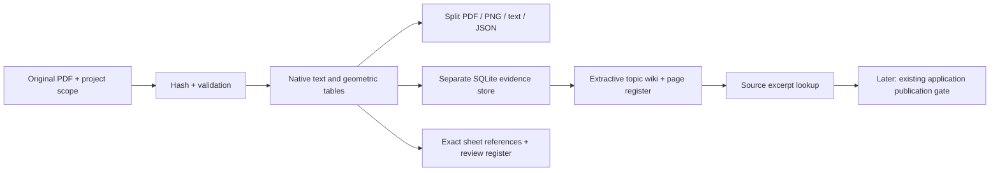

# PDF knowledge-package engine (isolated pilot)

Version: 0.1.1. Run from the Expo Design AI repository root with its installed Python 3.12 runtime. Uses existing PyMuPDF and the Python standard library; no installation, model download or cloud service is needed.

## Purpose

Convert a PDF into an independently stored, project-scoped knowledge package. The package retains original page evidence and provides concept-based navigation. It does not modify the application's uploads, database, FAISS index, permissions, model configuration or chat route.



## Build and query

PowerShell example, using this host's already provisioned runtime:

```powershell
$pilotPython = 'C:/Users/RE&DBIM/AppData/Local/Programs/Python/Python312/python.exe'
& $pilotPython -m engines.pdf_knowledge_engine build 'C:/path/to/source.pdf' --project 'Project name'
& $pilotPython -m engines.pdf_knowledge_engine query 'output/pdf-knowledge-pilot/packages/<project>/<package>' 'Parking calculation' --project 'Project name'
```

The build prints the exact package directory. Use that directory for query; never select an arbitrary newest folder as approval authority.

Each package contains:

| Artifact | Role |
|---|---|
| `source.pdf` | Hash-checked snapshot of the original source |
| `drawings_split/` | Individual pages as PDF, PNG, text and JSON |
| `drawings/` | Per-page Markdown evidence, with source links |
| `sheet_index.json` | Page/sheet identities and explicitly labelled revision/status observations |
| `sheet_classification.json` | Native/mixed/image-only classification and heading candidates |
| `drawings.md` | Page register |
| `project.md` | Project scope, source identity and package navigation |
| `cross_references.json` | Explicit sheet references with resolved/unresolved/ambiguous targets |
| `coordination_issues.md` | Evidence limitations and unresolved references; not automated engineering clash analysis |
| `concept_wiki/` | Draft topic indexes containing source excerpts and raw table grids |
| `db/project.sqlite` | Isolated evidence/topic store |
| `db/structured.json` | Full records with project/source/hash/page, bounding boxes and extraction state |
| `db/provenance_report.json` | Source provenance and interpretation-state definitions |
| `AI_CONTEXT.md` | Navigation guidance, separate from instructions embedded in source PDFs |
| `manifest.json` | Engine/options, source hash, completion state and hashes of all package artifacts |

## Evidence behavior

- Native extraction is `INTERPRETED`, never automatically `SOURCE_VERIFIED` or approved.
- Raw grids preserve cell order, empty cells, units, qualifiers and multirow source headers. Generic display columns avoid guessing which source row is the authoritative header.
- The engine uses simple domain-topic rules. This is an extractive concept wiki, not a complete semantic synthesis or an engineering review.
- PDF images, sparse native text and annotations require review. Their presence is recorded even if useful native text was extracted.
- No OCR starts implicitly. A caller may inject a named, already provisioned local OCR reader through the Python interface. All returned OCR observations remain `REVIEW_REQUIRED` and are excluded from lookup's source matches. Real OCR integration was not certified in this pilot.
- Topic assignment and bounding-box extraction do not prove a claim's engineering meaning. Approval authority remains `NOT_ESTABLISHED`.
- Exact labelled sheet IDs support reference navigation. Figure bubbles, spatial callouts, external discipline references and implicit relationships are not comprehensively parsed.
- Lookup is lexical, with diversity of requested terms. It returns original source excerpts, not a synthesized engineering answer. It cannot bypass the application's publication checks because it is not wired into `/ask_stream`.
- Project scope is an explicit local-tool parameter, not an authentication mechanism. Any future web route must enforce existing project/folder/private-attachment access rules before exposing packages.

## Publication and recovery

Outputs live under hashed project and content identities. Repeated builds validate/reuse an intact package. A changed source, filename, engine version or OCR reader identity gets a separate package. Existing revisions remain available; the engine does not choose a current/approved revision.

Writes happen in a `.building-*` directory. Only after extraction, the SQLite transaction, source-hash recheck and artifact verification does the directory publish under its final name. Failures remain `FAILED`; a hard process exit during construction leaves `BUILDING`. Such incomplete packages are not queryable. Retry creates a new staging directory. Stale staging directories are retained for diagnosis and require later housekeeping. No unattended recovery worker or stale-stage collector is supplied.

Limits default to 200 MB, 1,000 pages, and 1,400 pixels on the longest preview side. These are resource limits, not capacity certification. Table finding has no child-process timeout in this pilot. Do not expose arbitrary large uploads to a shared service before adding admission control and worker isolation.

## Reproduce evaluation

```powershell
& $pilotPython -m unittest tests.test_pdf_knowledge_engine -v
& $pilotPython tools/evaluate_pdf_knowledge_pilot.py --source-root 'C:/Users/RE&DBIM/Downloads'
& $pilotPython output/pdf-knowledge-pilot/run_regressions.py
& $pilotPython -m py_compile engines/pdf_knowledge_engine.py tests/test_pdf_knowledge_engine.py tools/evaluate_pdf_knowledge_pilot.py
```

Set `TEMP`, `TMP` and `TMPDIR` to a writable workspace folder when the desktop sandbox redirects the system temp folder. The regression runner does this and gives each existing test module an isolated test database.

The real-PDF evaluator verifies source SHA-256 values before checking its independently labelled rows/cover facts. It also executes the frozen 26-case claim benchmark unchanged, writing results only to the pilot output directory.

## Rollback

There are no application integration points to revert. Stop using the standalone CLI and remove only the new engine module, this guide, its test module, its fixture and its evaluation tool if desired. Generated packages and logs are under `output/pdf-knowledge-pilot/`; archive them before removal if needed. Do not reset or revert other workspace files.

The next independently testable step is a permission-aware, read-only project integration that sends selected original evidence through the existing final answer-publication gate. Local-model synthesis, broad PDF accuracy, real OCR, multi-document conflicts, load testing and deployment acceptance remain separate work.
