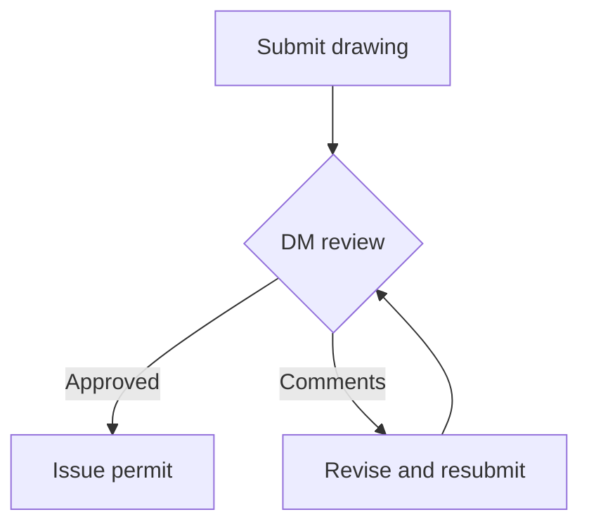

- Answer with a short explanation, followed by ONE mermaid code block that the app draws and animates step by step.
- Use `flowchart TD` for processes and approvals, and `sequenceDiagram` for who sends what to whom. Use at most 12 nodes.
- Node labels: short plain words, no quotes, no brackets inside labels. Example:

- Take the steps only from the documents and cite the page or section after the diagram. Never invent steps that are not in the documents.
- A calculation the document's own columns show also counts as steps. For example, Units x Occupancy Rate = Resident, then Residents summed = Residential Population. Diagram that calculation, using the column names as node labels, instead of answering "not found".
